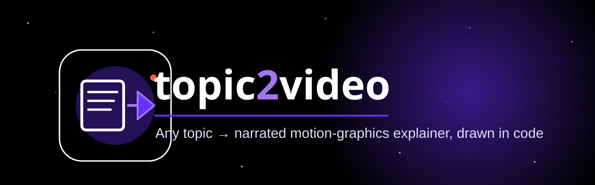

[English](README.md) · [हिन्दी](README.hi.md) · [اردو](README.ur.md) · [العربية](README.ar.md) · [Français](README.fr.md) · [Deutsch](README.de.md) · [Español](README.es.md) · [Italiano](README.it.md) · [Português](README.pt.md) · [Nederlands](README.nl.md) · **Русский** · [Polski](README.pl.md)

<p align="center">
  
</p>

# topic2video

Превращайте любую техническую или научную тему в озвученное обучающее видео в стиле motion graphics, полностью нарисованное кодом.

Дайте тему (или статью), и на выходе будет оригинальное обучающее видео на **китайском или английском**: чёрный холст, фон с полем звёзд или точек, белая линейная графика с фиолетовым акцентом, озвучка TTS, субтитры и полоса прогресса по главам. Каждый кадр рисуется с помощью [Remotion](https://www.remotion.dev/) (React), поэтому видео воспроизводимо и редактируется как исходный код.

Этот репозиторий — **навык Claude Code** (`SKILL.md`) вместе со справочными документами, протоколами агентов и компилируемым шаблоном проекта Remotion, который он использует.

## Что в репозитории

| Путь | Содержимое |
|---|---|
| `SKILL.md` | Точка входа навыка: жёсткие правила, четыре точки подтверждения для пользователя, восьмиэтапный рабочий процесс, индекс файлов |
| `template/` | Компилируемый проект Remotion 4: общая библиотека движения, UI-примитивы, компоненты глав/HUD/оверлея, шрифты (OFL) и скрипты для TTS, рендеринга раскадровки, стоп-кадров, превью, рендеринга и проверок |
| `reference/` | Руководство по стилю, словарь движений, правила композиции и освещения, формат сценария и раскадровки, бриф для исследования, промпты агентов и протоколы сборки/QC, извлечённые уроки |
| `examples/rag/` | Полный пример видео, *RAG and Knowledge Bases* (4′35″, китайская озвучка): исследование, сценарий, раскадровка, исходный код каждого кадра, отчёты QC и кадры. Используйте его как эталон качества |
| `examples/contrast/` | Пары кадров «до/после», показывающие правила композиции и освещения на практике |

## Требования

- Claude Code (для запуска рабочего процесса навыка)
- Node.js и npm (проект Remotion)
- Python 3 (скрипты TTS, раскадровки и метрик)
- Около 2 ГБ дискового пространства на каждый видеопроект

Настройку движка TTS смотрите в комментарии в заголовке `template/scripts/tts_build.py`.

## Быстрый старт

1. Положите эту папку туда, откуда Claude Code загружает навыки (например, `~/.claude/skills/anything2explainer`).
2. Попросите Claude Code сделать обучающее видео, например: *«Make a 4-minute explainer video about vector databases, in Chinese.»*
3. Claude следует `SKILL.md`: он спрашивает длительность и язык, затем останавливается на точках подтверждения (сценарий, голос и 30-секундное превью), прежде чем собирать полное видео.

Чтобы собрать проект вручную из шаблона:

```bash
template/scripts/new_project.sh <work-dir> <slug>
cd <work-dir>
npm run studio            # открывает студию Remotion для превью
```

## Благодарности и сторонние компоненты

- **Визуальное вдохновение**: стиль вдохновлён аккаунтом Douyin «图灵宇宙» (Turing Universe). Все кадры нарисованы кодом; кадры или записи из других видео не используются.
- **Шрифты**: Noto Sans SC, Orbitron, Exo 2 и Audiowide, все под SIL Open Font License 1.1. См. [`template/public/fonts/LICENSE.md`](template/public/fonts/LICENSE.md).
- **Рендеринг**: [Remotion](https://www.remotion.dev/). У Remotion собственная лицензия, не одобренная OSI. Её условия требуют корпоративную лицензию для некоторых коммерческих видов использования, поэтому проверьте их перед применением в бизнесе.
- **Голоса**: голос по умолчанию для китайского использует `edge-tts`, который обращается к онлайн-сервису речи Microsoft и подчиняется его условиям. Голос по умолчанию для английского использует `kokoro-82m` под лицензией Apache-2.0. Вы также можете предоставить собственный аудиофайл.

## Лицензия

Код и документация выпущены под [лицензией MIT](LICENSE). Шрифты сохраняют лицензию OFL, а перечисленные выше сторонние инструменты сохраняют собственные условия.
